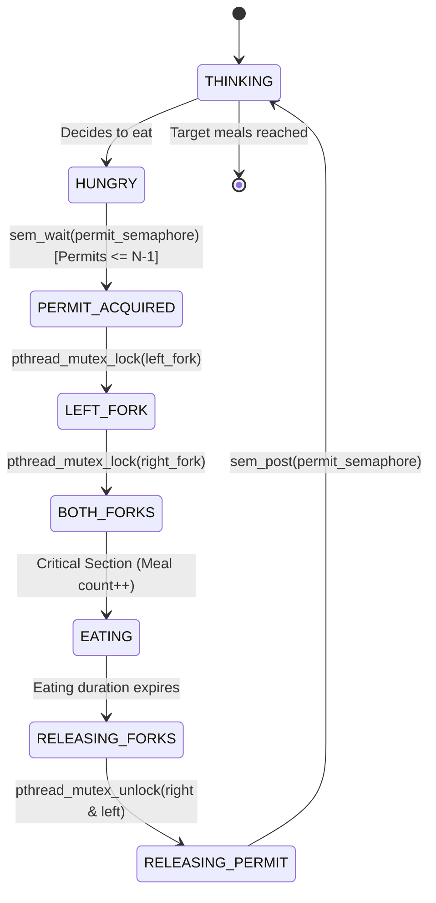

# Algorithm Specification & Mathematical Proof

## 1. Classical Problem Formulation

The **Dining Philosophers Problem** was originally proposed by Edsger W. Dijkstra in 1965 as an examination question on concurrent programming and synchronization. It models the fundamental challenge of allocating a finite set of shared reusable resources among competing concurrent processes without causing **deadlock** or **starvation**.

### System Definition
- A circular dining table has $N$ seats ($N \ge 2$, traditionally $N = 5$).
- $N$ philosophers $P_0, P_1, \dots, P_{N-1}$ sit around the table.
- Between each adjacent pair of philosophers lies exactly one shared fork $F_0, F_1, \dots, F_{N-1}$.
- Philosopher $P_i$ requires two adjacent forks:
  - Left Fork: $F_{\text{left}} = F_i$
  - Right Fork: $F_{\text{right}} = F_{(i + 1) \pmod N}$
- Each philosopher alternates continuously between two primary states:
  1. **Thinking:** Independent, non-resource-competing computation.
  2. **Eating:** Critical section requiring simultaneous exclusive access to both adjacent forks.

---

## 2. Coffman's Four Conditions for Deadlock

A system state is deadlocked if and only if all four conditions formulated by Edward G. Coffman Jr. (1971) hold simultaneously:

1. **Mutual Exclusion:** Each resource (fork) is held by at most one process (philosopher) at any time.
2. **Hold and Wait:** A process currently holding allocated resources can request additional resources while waiting.
3. **No Preemption:** Resources cannot be forcibly revoked from a process holding them; they must be released voluntarily.
4. **Circular Wait:** A closed chain of processes $\{P_0, P_1, \dots, P_{k-1}\}$ exists such that $P_i$ is waiting for a resource held by $P_{(i+1) \pmod k}$.

### The Naive Unsafe Scenario
In an uncontrolled implementation, if all $N$ philosophers become hungry at the same moment:
1. Every philosopher $P_i$ grabs their left fork $F_i$.
2. Every philosopher $P_i$ then attempts to acquire their right fork $F_{(i+1) \pmod N}$.
3. Because $F_{(i+1) \pmod N}$ is already held as the left fork of neighbor $P_{(i+1) \pmod N}$, all philosophers block indefinitely.
4. The system enters a circular wait:
   $$P_0 \to F_1 \to P_1 \to F_2 \to P_2 \dots \to P_{N-1} \to F_0 \to P_0$$
5. No thread can proceed, leading to permanent system deadlock.

---

## 3. The $N - 1$ Counting Semaphore Prevention Strategy

Our system prevents deadlock by **eliminating the Circular Wait condition** through concurrency throttling.

### Core Mechanism
- A global POSIX counting semaphore (`permit_semaphore`) is initialized to $N - 1$ (e.g., 4 permits for 5 philosophers).
- Before any philosopher is permitted to pick up either fork, they must acquire one permit from the semaphore (`sem_wait(&permit_semaphore)`).
- When eating is completed and both forks are released, the philosopher returns the permit (`sem_post(&permit_semaphore)`).



---

## 4. Formal Mathematical Proof of Deadlock Freedom

### Theorem
In a system of $N$ philosophers and $N$ forks arranged circularly, restricting the number of concurrent dining attempts to at most $N - 1$ using a counting semaphore guarantees freedom from deadlock.

### Proof by Contradiction
1. **Assumption:** Suppose the system reaches a deadlocked state under the $N - 1$ semaphore strategy.
2. **Definition of Deadlock:** In a deadlocked state, every competing philosopher must be blocked waiting to acquire a fork that is held by another philosopher.
3. **Pigeonhole Principle Application:**
   - Let $k$ be the number of philosophers currently holding permits and competing for forks.
   - By the semaphore invariant:
     $$k \le N - 1$$
   - Each competing philosopher holds at most 1 fork while waiting for their second fork (if any held 2 forks, that philosopher would be eating and making progress, contradicting the definition of deadlock).
   - Therefore, the total number of forks held across all competing philosophers is at most:
     $$\text{Forks Held} \le k \le N - 1$$
4. **Free Resource Existence:**
   - There are $N$ total forks in the system.
   - The number of free forks on the table is:
     $$\text{Free Forks} = N - \text{Forks Held} \ge N - (N - 1) = 1$$
   - Therefore, **at least one fork $F_{\text{free}}$ must be available on the table**.
5. **Progress Guarantee:**
   - Since at least one fork $F_{\text{free}}$ is unheld, the philosopher adjacent to $F_{\text{free}}$ who is waiting for it can immediately acquire it.
   - Having acquired their second fork, that philosopher starts eating, finishes their meal, releases both forks, and returns their semaphore permit.
   - This releases resources to waiting neighbors, allowing subsequent threads to make progress.
6. **Contradiction:**
   - This directly contradicts the initial assumption that all philosophers are permanently blocked and unable to proceed.
   - Hence, deadlock is impossible under this protocol. $\blacksquare$

---

## 5. Pseudocode

### 5.1 Philosopher Thread Routine
```c
void* philosopher_thread(void* arg) {
    int id = *(int*)arg;
    int left_fork = id;
    int right_fork = (id + 1) % N;

    while (!stop_requested && meals_eaten < max_meals) {
        // 1. Thinking Phase
        set_state(id, STATE_THINKING);
        sleep_ms(speed_ms);

        // 2. Hungry Phase
        set_state(id, STATE_HUNGRY);

        // 3. Acquire Table Permit (Breaks circular wait)
        sem_wait(&permit_semaphore);

        // 4. Acquire Left Fork
        pthread_mutex_lock(&fork_mutexes[left_fork]);
        record_fork_owner(left_fork, id);

        // 5. Acquire Right Fork
        pthread_mutex_lock(&fork_mutexes[right_fork]);
        record_fork_owner(right_fork, id);

        // 6. Eating Phase (Critical Section)
        set_state(id, STATE_EATING);
        meals_eaten++;
        sleep_ms(speed_ms);

        // 7. Release Both Forks
        record_fork_owner(right_fork, -1);
        pthread_mutex_unlock(&fork_mutexes[right_fork]);

        record_fork_owner(left_fork, -1);
        pthread_mutex_unlock(&fork_mutexes[left_fork]);

        // 8. Release Table Permit
        sem_post(&permit_semaphore);
    }
    set_state(id, STATE_COMPLETED);
    return NULL;
}
```

### 5.2 Monitor & Watchdog Thread Routine
```c
void* monitor_thread(void* arg) {
    while (!stop_requested) {
        sleep_ms(100);

        pthread_mutex_lock(&state_mutex);
        if (strategy == STRATEGY_UNSAFE) {
            // Check if all N philosophers hold 1 fork and wait for the second
            if (count_holding_one_fork() == N) {
                deadlock_occurred = true;
                emit_event(EVENT_DEADLOCK_DETECTED, "Circular wait confirmed");
            }
        }

        if (all_philosophers_completed()) {
            emit_event(EVENT_FINISHED, "All configured meals completed");
            break;
        }
        pthread_mutex_unlock(&state_mutex);
    }
    return NULL;
}
```

---

## 6. Comparison of Deadlock Strategies

| Metric | Deadlock Prevention (This Project) | Deadlock Avoidance (Banker's Alg) | Deadlock Detection & Recovery |
| :--- | :--- | :--- | :--- |
| **Strategy Mechanism** | Eliminates circular wait statically via semaphore | Dynamically tracks safe vs. unsafe states | Allows deadlock; detects cycles via graph |
| **Time Complexity** | $\mathcal{O}(1)$ semaphore decrement/increment | $\mathcal{O}(m \times n^2)$ per allocation request | $\mathcal{O}(V + E)$ cycle finding on WFG |
| **A-priori Knowledge** | None required | Requires maximum claim matrix | None required |
| **Resource Utilization** | Conservative ($\le N-1$ diners) | Optimal within declared safe bounds | Maximum until deadlock occurs |
| **Recovery Overhead** | None; deadlocks never occur | None; requests delayed if unsafe | High (transaction abort or thread termination) |
| **Suitability** | Real-time & embedded systems | Batch processing systems | Database management systems (DBMS) |
