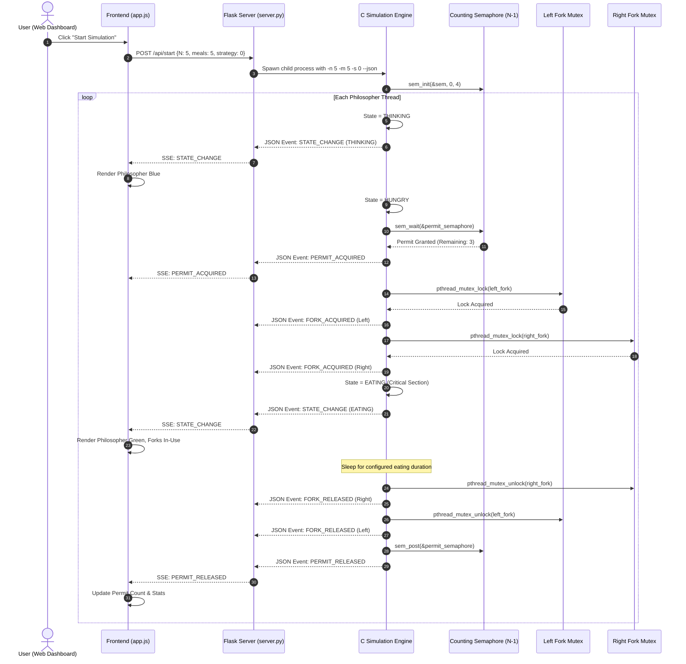

# System Design & Architecture Specification

## 1. Architectural Overview

The **Dining Philosophers Deadlock Prevention System** follows a clean multi-tier architecture separating high-performance concurrent systems programming from interactive presentation and monitoring:

```
┌─────────────────────────────────────────────────────────────┐
│                    WEB PRESENTATION TIER                    │
│   HTML5 Canvas/SVG Arena │ Chart.js Analytics │ Event Log   │
└──────────────────────────────┬──────────────────────────────┘
                               │ HTTP REST & SSE Stream
┌──────────────────────────────▼──────────────────────────────┐
│                  INTEGRATION & CONTROL TIER                 │
│        Python Flask Server (backend/server.py)              │
│   Process Lifecycle │ Command Pipe │ JSON Stream Buffer     │
└──────────────────────────────┬──────────────────────────────┘
                               │ stdin/stdout Pipes
┌──────────────────────────────▼──────────────────────────────┐
│                 SIMULATION CONCURRENCY ENGINE               │
│               POSIX C Executable (GCC / Linux)              │
│   Philosopher Threads (pthread) │ Fork Mutexes (mutex)      │
│   Permit Counting Semaphore     │ Condition Variables       │
└─────────────────────────────────────────────────────────────┘
```

---

## 2. Component Breakdown

### 2.1 Backend Simulation Engine (C / POSIX)
- **Source Files:** `src/simulation.h`, `src/simulation.c`, `src/dining_philosophers.c`.
- **Concurrency Model:** Multi-threaded shared-memory model using `pthread`.
- **Synchronization Primitives:**
  - `pthread_mutex_t fork_mutexes[N]`: One mutual exclusion lock per fork.
  - `sem_t permit_semaphore`: Counting semaphore initialized to $N - 1$.
  - `pthread_mutex_t state_mutex`: Protects shared statistical state from race conditions.
  - `pthread_cond_t pause_cond`: Condition variable enabling instantaneous thread pause/resume without busy-waiting.
  - `pthread_barrier_t deadlock_barrier`: Thread barrier used in Unsafe mode to align all philosophers for deterministic circular wait.
- **Event Dispatcher:** Emits timestamped JSON events to `stdout` upon every state transition, lock acquisition, or release.

### 2.2 Integration Layer (Python Flask)
- **Source File:** `backend/server.py`.
- **Process Management:** Launches the compiled C executable as a managed child subprocess.
- **Bidirectional Communication:**
  - **Downstream (Engine to Web):** Ingests JSON event stream from C engine's `stdout` in a dedicated reader thread, maintains an event history buffer, and streams updates to web clients via Server-Sent Events (SSE).
  - **Upstream (Web to Engine):** Translates frontend HTTP control requests (`/api/pause`, `/api/resume`, `/api/step`, `/api/speed`, `/api/stop`) into commands written directly to the C process's `stdin`.
- **Fault Tolerance:** Isolates child process execution with timeouts, ensuring the server remains responsive even during intentional deadlock demonstrations.

### 2.3 Frontend Dashboard (HTML5 / CSS3 / Vanilla JavaScript)
- **Source Files:** `frontend/index.html`, `frontend/style.css`, `frontend/app.js`.
- **Circular Arena Visualization:** Mathematically positions $N$ philosopher nodes and $N$ forks around a circular dining table using trigonometry.
- **Dynamic State Engine:** Real-time color coding and pulse animations reflecting philosopher states (Thinking: Blue, Hungry: Amber, Eating: Green, Deadlocked: Crimson).
- **Interactive Analytics:** Live Chart.js graphs displaying completed meals and cumulative waiting times per philosopher.

---

## 3. End-to-End Sequence Diagram

The following sequence diagram illustrates the lifecycle of a dining attempt under the Deadlock Prevention strategy:



---

## 4. Concurrency Safety & Invariant Guarantees

1. **Race Condition Prevention:**
   All mutations to philosopher states, meal counters, wait times, and fork ownership records occur inside critical sections guarded by `pthread_mutex_lock(&ctx->state_mutex)`.

2. **Clean Pause/Resume Protocol:**
   Pause requests do not freeze threads while holding fork mutexes. Philosophers evaluate `check_pause_and_stop()` at safe boundaries (outside fork acquisitions). Threads wait on `pthread_cond_wait(&pause_cond, &pause_mutex)`, eliminating the risk of deadlock induced by pausing.

3. **Graceful Cancellation & Cleanup:**
   When a simulation is stopped or reset:
   - Atomic flag `ctx->stop_requested` is asserted.
   - `pthread_cond_broadcast(&pause_cond)` wakes all paused threads.
   - All held fork locks and permits are released.
   - `pthread_join()` collects all child threads before synchronization primitives are destroyed via `pthread_mutex_destroy()` and `sem_destroy()`.
